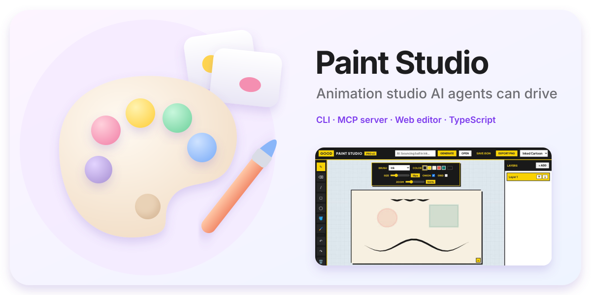
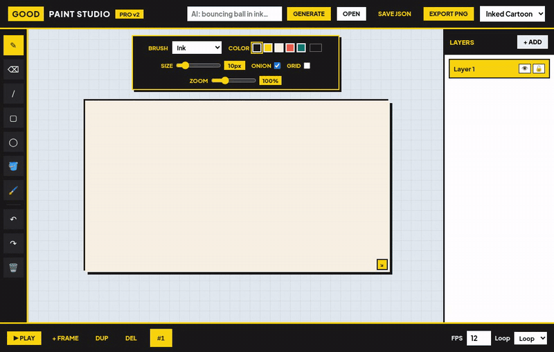
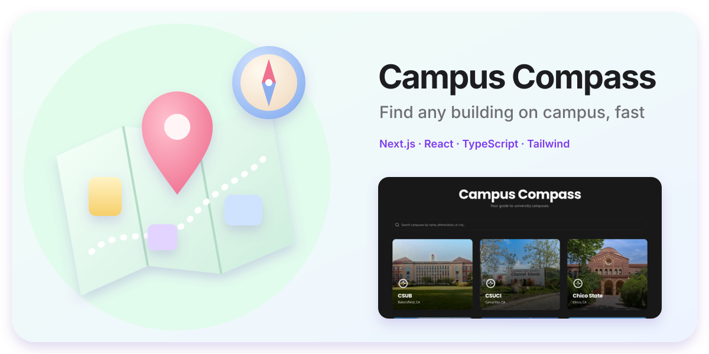
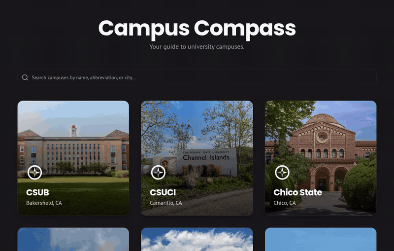

I build and ship AI-powered apps fast with coding agents.

## Paint Studio

**[Live demo](https://mazin7d4.github.io/PaintWebApp/)** · **[Code](https://github.com/Mazin7d4/PaintWebApp)**

Built with: TypeScript · Vite · Node.js CLI · MCP server · GitHub Pages

## Campus Compass

**[Live demo](https://campus-compass-beige-six.vercel.app)** · **[Code](https://github.com/Mazin7d4/Campus-Compass)**

Built with: Next.js · React · TypeScript · Tailwind CSS · Radix UI · Vercel
